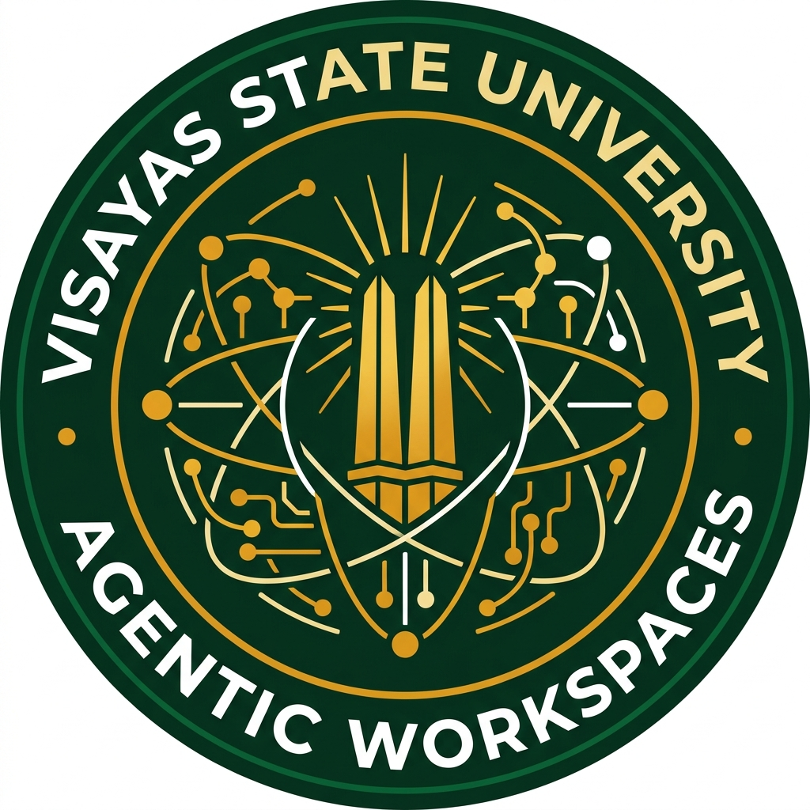
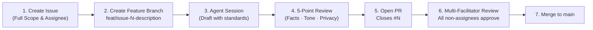

<!-- ============================================================================== -->
<!-- VISAYAS STATE UNIVERSITY (VSU)                                                 -->
<!-- TECHNICAL WORKING GROUP FOR AGENTIC WORKSPACES                                 -->
<!-- GitHub Organization Profile README (Public & Members View)                     -->
<!-- ============================================================================== -->

<div align="center">

  

  # Visayas State University
  ## Technical Working Group for Agentic Workspaces

  <p>
    <a href="https://www.vsu.edu.ph"></a>
    <a href="https://brandbook.vsu.edu.ph"></a>
    <a href="https://github.com/vsu-twg-for-agentic-workspaces"></a>
    <a href="#-data-privacy--ai-ethics-framework"></a>
  </p>

  <p align="center">
    <strong>Advancing AI Agents, Orchestrated Workflows, and Collaborative Digital Spaces across the VSU System</strong><br/>
    <em>Instruction • Research • Extension • Production</em>
  </p>

  <p align="center">
    <a href="#-public-overview"><strong>🌐 Public Overview</strong></a> •
    <a href="#-initiatives--repositories"><strong>📚 Repositories</strong></a> •
    <a href="#-twg-members--contributor-workspace"><strong>👥 Members Workspace</strong></a> •
    <a href="#-ai-safety--governance"><strong>🛡️ AI Governance</strong></a> •
    <a href="#-facilitators--contact"><strong>📬 Contact</strong></a>
  </p>

</div>

---

## 🌐 Public Overview

### Institutional Mandate
The **VSU Technical Working Group (TWG) for Agentic Workspaces** was established to spearhead the ethical adoption, technical enablement, and systematic integration of autonomous and human-in-the-loop AI agents across Visayas State University.

Grounded in VSU's core institutional values of **Relevance, Integrity, Truth, and Excellence (RITE)**, the TWG develops practical frameworks, reusable templates, and hands-on capacity building programs that empower faculty, researchers, and administrative personnel to streamline workflows without compromising data privacy or institutional standards.

```text
       ┌────────────────────────────────────────────────────────┐
       │   Visayas State University — Core Institutional Seal   │
       │     Instruction • Research • Extension • Production    │
       └───────────────────────────┬────────────────────────────┘
                                   │
              ┌────────────────────┴───────────────────┐
              ▼                                        ▼
   ┌───────────────────────┐                ┌───────────────────────┐
   │ Academic Productivity │                │ Operational Workflows │
   │ • Syllabus generation │                │ • Document drafting   │
   │ • Literature reviews  │                │ • Records management  │
   │ • Research pipelines  │                │ • Process automation  │
   └──────────┬────────────┘                └───────────┬───────────┘
              │                                         │
              └────────────────────┬────────────────────┘
                                   ▼
                 ┌───────────────────────────────────┐
                 │    VSU TWG Agentic Workspaces     │
                 │ Multi-Agent Workflows & Standards │
                 └───────────────────────────────────┘
```

### Strategic Mission & Vision
- **🎯 Mission:** Democratize artificial intelligence and agentic workflow automation for all VSU academic and administrative personnel through hands-on training, standard operating procedures, and institutional repository templates.
- **🔭 Vision:** A unified, digitally empowered university where faculty and staff effortlessly orchestrate intelligent AI agents to eliminate administrative friction and amplify academic productivity.

---

## 📚 Initiatives & Repositories

| Repository | Scope | Target Audience | Status |
|---|---|---|---|
| [**`capacity-building-in-using-ai-agents-and-workflows-in-university`**](https://github.com/vsu-twg-for-agentic-workspaces/capacity-building-in-using-ai-agents-and-workflows-in-university) | Comprehensive 2-day training design, lab handouts, slide decks, and participant rubrics | Faculty, Non-Technical Staff | 🟢 Active Training |
| [**`participant-repo-template`**](https://github.com/vsu-twg-for-agentic-workspaces/participant-repo-template) | 1-click starter repository template equipped with preconfigured `.gemini` settings, prompts, and lab exercises | Workshop Learners | 🟢 Active Template |
| [**`.github`**](https://github.com/vsu-twg-for-agentic-workspaces/.github) | Organization profile, community health files, issue templates, and shared guidelines | Public & Members | 🟢 Maintained |

---

## 🛡️ AI Safety & Governance

Every AI agent workflow developed under this organization is bounded by strict ethical and statutory safeguards:

> [!CAUTION]
> ### Compliance with the Philippine Data Privacy Act (RA 10173)
> **Never upload or paste real personal data** (student ID numbers, grades, payroll slips, personnel records, or confidential administrative memos) into public AI prompts or cloud LLMs. Always use synthesized, anonymized, or mock records.

### The 5-Point AI Review Checklist
Before any AI-generated deliverable is merged or distributed, contributors must verify:
- [x] **Facts** — Are names, dates, policy references, and figures factually accurate?
- [x] **Sources** — Is every cited source, memorandum, or reference real and verifiable?
- [x] **Tone** — Does the language match official university voice and respectful academic norms?
- [x] **Privacy** — Is all content sanitized of student or personnel private identifiable information (PII)?
- [x] **Ownership** — Has a human author reviewed, edited, and taken full responsibility for the output?

---

<details open>
<summary><h2>👥 TWG Members & Contributor Workspace</h2></summary>

> [!NOTE]
> This section serves as the collaborative operational manual for TWG members, facilitators, and campus contributors.

### 1. New Member Onboarding
1. **GitHub Setup:** Ensure your account is added to the [`vsu-twg-for-agentic-workspaces`](https://github.com/vsu-twg-for-agentic-workspaces) organization with appropriate team permissions.
2. **VSU Brand Book:** Familiarize yourself with the visual and typographical standards codified in [`resources/vsu-brandbook.md`](https://github.com/vsu-twg-for-agentic-workspaces/capacity-building-in-using-ai-agents-and-workflows-in-university/blob/main/resources/vsu-brandbook.md).
3. **Agentic Memory (`AGENTS.md`):** Every repository carries an `AGENTS.md` file setting the shared operating context for AI coding assistants (Antigravity, Claude, Copilot, Cursor). Always read this file before starting tasks.

### 2. Issue-First Development Mandate
No task, curriculum change, or code addition may proceed without a registered GitHub Issue:



### 3. Multi-Facilitator Peer Review Policy
To guarantee consistency across university deliverables:
- Every Pull Request **must be reviewed and approved by all other facilitators** excluding the PR assignee/author.
- Merging without unanimous consensus from non-assignee facilitators is strictly prohibited.
- Once merged, the author updates the tracker in `PROGRESS.md`.

### 4. AI Model Tier Allocation Matrix
Choose the appropriate AI model tier to conserve quota and maintain high performance:

| Task Tier | Recommended Models | Examples |
|---|---|---|
| **Light / Formatting** | Fast, free-tier models | Gemini Flash, Claude Haiku, GPT-4o-mini |
| **Drafting & Labs** | Balanced reasoning models | Claude Sonnet, GPT-4o, Gemini Pro |
| **Curriculum & Architecture** | Advanced reasoning models | Claude Opus / Sonnet-Thinking, GPT-o3 |
| **Workflow Generation** | Code-specialized agents | Antigravity, GitHub Copilot, Codex |

</details>

---

## 🎨 Visual Identity & Brand Assets

The TWG for Agentic Workspaces adheres strictly to official VSU branding guidelines:

| Brand Element | Official Specification | Hex Code |
|---|---|---|
| **VSU Forest Green** | Primary base, banners, headers | `#0D5C3A` |
| **VSU Harvest Gold** | Primary accent, milestones, highlights | `#D97706` |
| **VSU Golden Yellow** | Secondary accent, badges | `#F59E0B` |
| **VSU Deep Pine** | High contrast, dark backgrounds | `#083D26` |
| **Slate Dark** | Primary body copy, terminal blocks | `#1E293B` |

Official vector logos and emblem avatars are available in the [`profile/assets/`](profile/assets/) folder:
- **`vsu-twg-avatar.png`** — High-resolution organization avatar (512x512)
- **`vsu-twg-logo-horizontal.svg`** — Scalable horizontal lockup for banners and headers
- **`vsu-twg-avatar.svg`** — Scalable vector organization emblem

---

## 📬 Facilitators & Contact

- **Lead Facilitator:** **Jomari Joseph A. Barrera**, Assistant Professor I, Department of Computer Science & Technology (DCST) — `jomarijoseph.barrera@vsu.edu.ph`
- **Co-Facilitator:** **Kyle Anthony F. Nierras**, Instructor, Department of Computer Science & Technology (DCST)
- **Co-Facilitator:** **Graeme Xyber N. Pastoril**, Instructor, Department of Computer Science & Technology (DCST)
- **Institutional Home:** Visayas State University, Baybay City, Leyte, 6521 Philippines

---

<div align="center">
  <small>© 2026 Visayas State University • Technical Working Group for Agentic Workspaces<br/>
  Released under CC BY-NC-SA 4.0 & MIT License</small>
</div>
