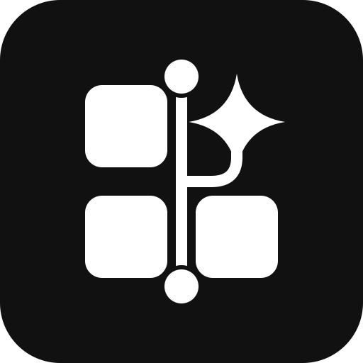

<!-- ============================================================================== -->
<!-- VISAYAS STATE UNIVERSITY (VSU)                                                 -->
<!-- TECHNICAL WORKING GROUP FOR AGENTIC WORKSPACES                                 -->
<!-- GitHub Organization Profile README (Public View)                               -->
<!-- Members-only content lives in .github-private/profile/README.md                -->
<!-- ============================================================================== -->

<div align="center">

  <picture>
    <source media="(prefers-color-scheme: dark)" srcset="./assets/vsu-twg-logo-horizontal-white.svg" />
    
  </picture>

  <br/><br/>

  <p>
    <a href="https://www.vsu.edu.ph"></a>
    <a href="https://brandbook.vsu.edu.ph"></a>
    <a href="https://github.com/vsu-twg-for-agentic-workspaces"></a>
    <a href="#%EF%B8%8F-ai-safety--governance"></a>
  </p>

  <p align="center">
    <strong>Advancing AI Agents, Orchestrated Workflows, and Collaborative Digital Spaces across the VSU System</strong><br/>
    <em>Instruction • Research • Extension • Production</em>
  </p>

  <p align="center">
    <a href="#-public-overview"><strong>🌐 Overview</strong></a> •
    <a href="#-initiatives--repositories"><strong>📚 Initiatives</strong></a> •
    <a href="#%EF%B8%8F-ai-safety--governance"><strong>🛡️ AI Governance</strong></a> •
    <a href="#-visual-identity"><strong>🎨 Visual Identity</strong></a> •
    <a href="#-facilitators--contact"><strong>📬 Contact</strong></a>
  </p>

</div>

---

## 🌐 Public overview

### Institutional mandate
The **VSU Technical Working Group (TWG) for Agentic Workspaces** was established to spearhead the ethical adoption, technical enablement, and systematic integration of autonomous and human-in-the-loop AI agents across Visayas State University.

Grounded in VSU's core institutional values of **Relevance, Integrity, Truth, and Excellence (RITE)**, the TWG develops practical frameworks, reusable templates, and hands-on capacity building programs that empower faculty, researchers, and administrative personnel to streamline workflows without compromising data privacy or institutional standards.

```text
       ┌────────────────────────────────────────────────────────┐
       │   Visayas State University — Core Institutional Seal   │
       │     Instruction • Research • Extension • Production    │
       └───────────────────────────┬────────────────────────────┘
                                   │
              ┌────────────────────┴───────────────────┐
              ▼                                        ▼
   ┌───────────────────────┐                ┌───────────────────────┐
   │ Academic Productivity │                │ Operational Workflows │
   │ • Syllabus generation │                │ • Document drafting   │
   │ • Literature reviews  │                │ • Records management  │
   │ • Research pipelines  │                │ • Process automation  │
   └──────────┬────────────┘                └───────────┬───────────┘
              │                                         │
              └────────────────────┬────────────────────┘
                                   ▼
                 ┌───────────────────────────────────┐
                 │    VSU TWG Agentic Workspaces     │
                 │ Multi-Agent Workflows & Standards │
                 └───────────────────────────────────┘
```

### Mission and vision
- **🎯 Mission:** Democratize artificial intelligence and agentic workflow automation for all VSU academic and administrative personnel through hands-on training, standard operating procedures, and institutional repository templates.
- **🔭 Vision:** A unified, digitally empowered university where faculty and staff effortlessly orchestrate intelligent AI agents to eliminate administrative friction and amplify academic productivity.

---

## 📚 Initiatives & repositories

| Initiative | Scope | Target audience | Status |
|---|---|---|---|
| **Capacity Building in Using AI Agents and Workflows in the University** | 2-day hands-on training design, lab handouts, slide decks, and participant rubrics | Faculty, non-technical staff | 🟢 Active training |
| **Participant repository template** | One-click starter repository with prompts and lab exercises for workshop learners | Workshop participants | 🟢 Active template |
| [**`.github`**](https://github.com/vsu-twg-for-agentic-workspaces/.github) | Organization profile, community health files, issue templates, and shared guidelines | Public & members | 🟢 Maintained |

> [!NOTE]
> Training repositories stay private to TWG members and enrolled participants while materials are in development. Members see the full repository list and contributor workflow in the members-only view of this page.

---

## 🛡️ AI safety & governance

Every AI agent workflow developed under this organization is bounded by strict ethical and statutory safeguards:

> [!CAUTION]
> ### Compliance with the Philippine Data Privacy Act (RA 10173)
> **Never upload or paste real personal data** (student ID numbers, grades, payroll slips, personnel records, or confidential administrative memos) into public AI prompts or cloud LLMs. Always use synthesized, anonymized, or mock records.

### The 5-point AI review checklist
Before any AI-generated deliverable is merged or distributed, contributors must verify:
- [x] **Facts** — Are names, dates, policy references, and figures factually accurate?
- [x] **Sources** — Is every cited source, memorandum, or reference real and verifiable?
- [x] **Tone** — Does the language match official university voice and respectful academic norms?
- [x] **Privacy** — Is all content sanitized of student or personnel private identifiable information (PII)?
- [x] **Ownership** — Has a human author reviewed, edited, and taken full responsibility for the output?

---

## 🎨 Visual identity

<p align="center">
  
  &nbsp;&nbsp;
  
  &nbsp;&nbsp;
  
  &nbsp;&nbsp;
  
</p>

The TWG logo, **"Branching Quadrant,"** follows the VSU Brand Book's centennial rule for non-academic units: a soft-rounded square, flat shapes, and no more than three colors. Three workspace tiles and an AI spark fill the four quadrants, echoing the four columns of the VSU seal. A main line runs through the gaps from start to finish, and a branch grows into the spark: the agent drafts work on a branch before people review and merge it.

| Logo color | Use | Hex code |
|---|---|---|
| **TWG Blue** | Square field, logotext | `#123F8C` |
| **TWG Silver** | Workspace tiles | `#C4CBD6` |
| **White** | Branch, nodes, and spark | `#FFFFFF` |

Training materials continue to use the official VSU **Green and Gold** palette (`#0D5C3A`, `#D97706`) from [brandbook.vsu.edu.ph](https://brandbook.vsu.edu.ph).

Logo files are in [`profile/assets/`](assets/):
- **`vsu-twg-logo.svg` / `.png`** — Primary logo (blue, silver, and white)
- **`vsu-twg-logo-simple.svg`**, **`-black.svg`**, **`-white.svg`**, **`-outline.svg`** — One-color and outlined versions
- **`vsu-twg-logo-round.svg`** — Round version for social-media profile photos
- **`vsu-twg-avatar.png`** — Organization avatar (1024 × 1024)
- **`vsu-twg-logo-horizontal.svg` / `.png`** and **`-horizontal-white.svg`** — Horizontal lockups for banners and headers

---

## 📬 Facilitators & contact

- **Lead Facilitator:** **Jomari Joseph A. Barrera**, Assistant Professor I, Department of Computer Science & Technology (DCST) — `jomarijoseph.barrera@vsu.edu.ph`
- **Co-Facilitator:** **Kyle Anthony F. Nierras**, Instructor, Department of Computer Science & Technology (DCST)
- **Co-Facilitator:** **Graeme Xyber N. Pastoril**, Instructor, Department of Computer Science & Technology (DCST)
- **Institutional Home:** Visayas State University, Baybay City, Leyte, 6521 Philippines

---

<div align="center">
  <small>© 2026 Visayas State University • Technical Working Group for Agentic Workspaces<br/>
  Released under CC BY-NC-SA 4.0 & MIT License</small>
</div>
